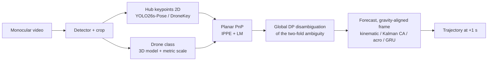

# DroneKey

**From monocular video of a quadrotor to a one-second trajectory forecast: keypoints, 6-DoF pose, forecasting.**

Code accompanying the Master's thesis *Review of drone movements in the air during flight using pose estimation techniques*, Pietro Giola, University of Udine, MSc Artificial Intelligence and Cybersecurity, a.y. 2025-2026.

The Python package is called `dronepose`. The repository root holds the code, configurations, scripts and tests; datasets, trained weights and experiment outputs are not included (see [Data](#data)).

## Summary

The project builds a three-stage pipeline that takes video of a single quadrotor and predicts where it will be one second later. First, a keypoint stage finds the 2D positions of the four propeller hubs (YOLO26s-Pose with a detector plus crop model, and a re-implementation of DroneKey for comparison). Second, a pose stage recovers the 6-DoF pose with planar PnP (IPPE followed by Levenberg-Marquardt refinement) and resolves the two-fold ambiguity of planar targets with a global dynamic-programming choice over the whole sequence. Third, a forecasting stage predicts the trajectory in a gravity-aligned frame, comparing kinematic baselines, a Kalman constant-acceleration filter, a generalised acro physics model and residual GRU networks. A drone-class stage selects the 3D model and the metric scale.

Training and evaluation use the synthetic 6DroneSyn dataset (audited and canonicalised here), plus a real-data transfer test on the DJI Mavic 2 of MAV6D.

## Pipeline



## Results

All numbers below are the ones reported in the thesis.

| Topic | Result |
|---|---|
| Flips (rotation error > 90 deg) | 11.1% frame by frame; 0.00% on tuning data and 0.19-1.35% held out with the global strategy (drone 08, which is near-symmetric, excluded) |
| Keypoints, 6DroneSyn test | YOLO26s pipeline: median rotation error 1.25 deg at 39.9 FPS on a T4. DroneKey re-implementation: 1.04 deg (significant in 1 seed of 3) |
| Pose stage (LM refinement, predicted class) | 1.33 deg on test (1.17 deg with the true class) |
| Forecast at 1 s, 6DroneSyn test | 0.061 m from ground-truth poses; 0.250 m from estimated poses |
| Drone class | Class fusion 76.4% to 93.3%; crop classifier 98.6% (forecast error 0.160 m) |
| Generated physical trajectories | Generalised acro beats the best kinematic forecaster by 44.6-58.0%; residual GRU adds a further 33.1% |
| Real data (MAV6D Mavic 2, authors' test split, measured once) | Synthetic-only models: about 50 deg / 47 deg median rotation error. With copy-paste on COCO backgrounds plus motion blur (no real frames in training): 9.2 deg / 9.0 deg with the true box, 12.4 deg / 10.6 deg with the retrained detector (recall 63.4%) |

No forecast on real data is reported.

## Repository structure

```
src/dronepose/        installable package
  common/             geometry, run registry, timing
  data/               6DroneSyn and MAV6D readers, canonicalisation, drone models, crop/YOLO export
  keypoints/          YOLO and DroneKey predictors, two-stage composite, class scores
  pose/               PnP solvers, disambiguation (frame-by-frame and global), error archive
  eval/               metrics, bootstrap, class and recipe selection, unit conventions
  forecast/           baselines, acro model, trajectory generator, datasets, evaluation
  trajectory/         baseline trajectory predictors
  pipeline/           integrated pipeline: perception, class, decision, streaming, forecast, drawing
  viz/                overlays
  backup/             data manifest
scripts/              entry points (data building, evaluation, training, demos)
  kaggle/             training and benchmark scripts written to run on Kaggle
  forecast/           trajectory generation, baselines, forecast videos, networks
  pipeline/           perception cache, streaming evaluation, timing
  class/              drone-class evaluation
  dronekey/           DroneKey re-implementation: data, evaluation, analysis
  real/               MAV6D preparation, evaluation and final test
  aug/                backgrounds and masks for copy-paste augmentation
  audit/              dataset audits
configs/              JSON configuration (drone models, DroneKey, forecast, generator, pipeline) and YOLO data YAMLs
tests/                pytest suite
```

## Installation

Python 3.10 or newer.

```bash
python3 -m venv .venv
.venv/bin/python -m pip install -e ".[dev]"
```

Optional extras, defined in `pyproject.toml`:

- `train`: `ultralytics` (YOLO26s-Pose training and inference)
- `nets`: `torch`, `torchvision` (residual GRU forecasting networks, DroneKey)
- `plots`: `matplotlib`

`requirements-lock.txt` pins the versions used for the experiments.

## Data

Neither dataset is included in the repository.

- **6DroneSyn** (synthetic). Its licence does not allow redistribution, so it is not distributed here, and neither are derived caches. Scripts read it from the path in the `SIXDRONESYN_ROOT` environment variable.
- **MAV6D** (real, used for the Mavic 2 transfer experiments): Zheng et al., IEEE Transactions on Robotics 40, 2967-2983 (2024). Code and links: https://github.com/WindyLab/MAV6D.
- **DroneKey** (comparison baseline): https://github.com/kkanuseobin/DroneKey, with its 2DroneKey dataset.

Model weights (`*.pt`), archives, videos and experiment outputs are excluded by `.gitignore`.

Rebuilding the derived data from a local copy of 6DroneSyn:

```bash
export SIXDRONESYN_ROOT=/path/to/6DroneSyn
.venv/bin/python scripts/build_drone_models.py
.venv/bin/python scripts/build_canonical.py
.venv/bin/python scripts/build_yolo_crops.py
.venv/bin/python scripts/package_cache.py
```

## Tests

```bash
.venv/bin/python -m pytest                                  # no dataset needed
SIXDRONESYN_ROOT=/path/to/6DroneSyn .venv/bin/python -m pytest   # also runs the tests marked `dataset`
```

## Usage

Most scripts document their arguments in the module docstring at the top of the file. Examples of the main entry points:

```bash
# Pose evaluation on saved keypoints: solver x refinement x strategy x drone class (validation selects, test reports)
python scripts/eval_e3.py --split val --det DETS.jsonl --seed s0=KPTS.jsonl --out OUT.json

# Export poses for the forecast stage
python scripts/export_poses.py --combo ippe+lm+global --det DETS.jsonl --split val --seed 0 \
    --kpts KPTS.jsonl --out-dir experiments --archive

# Forecast baselines on the validation windows
python scripts/forecast/run_baselines.py --split val

# Baselines on generated physical trajectories
python scripts/forecast/run_generated.py --split val

# Integrated pipeline demo, offline or streaming, on a 6DroneSyn validation sequence
python scripts/demo.py --sequence 14_02_07_000 --mode streaming --W 60 --out OUT.mp4

# Same demo on MAV6D (authors' train split only)
python scripts/demo.py --source mav6d --sequence SEQ --config configs/pipeline_mav6d.json \
    --mode streaming --out OUT.mp4 --no-forecast
```

Training scripts for YOLO-Pose and DroneKey are in `scripts/kaggle/` (`train_yolo_pose.py`, `train_dronekey.py`); they were run on Kaggle and locate their inputs under `/kaggle/input`. The demos and several evaluation scripts need the trained weights and the data caches, which are not part of the repository, and `ffmpeg` for video output.

## Reproducibility

- The test split of each experiment is used once. Selection of methods and parameters is done on validation data; the scripts that touch test data require an explicit `--allow-test` flag and several refuse to overwrite existing output.
- The MAV6D authors' test split was measured a single time, with a recipe frozen beforehand.
- Runs record the code commit, data hash, library versions and GPU in `run_info.json`.
- Keypoint results are reported over three seeds where noted.

## Citation

```bibtex
@mastersthesis{giola2026dronekey,
  author = {Giola, Pietro},
  title  = {Review of drone movements in the air during flight using pose estimation techniques},
  school = {University of Udine},
  year   = {2026},
  note   = {MSc in Artificial Intelligence and Cybersecurity},
  url    = {https://github.com/JuicyTomato/DroneKey}
}
```

If you use the MAV6D experiments, please also cite: Zheng et al., IEEE Transactions on Robotics 40, 2967-2983 (2024).

## Acknowledgements

Supervisor: Gianluca Foresti. Co-supervisor: Ivan Scagnetto.

## Licence

The code is released under the [MIT licence](LICENSE). The datasets (6DroneSyn, MAV6D) are not covered by it and keep their own terms.
